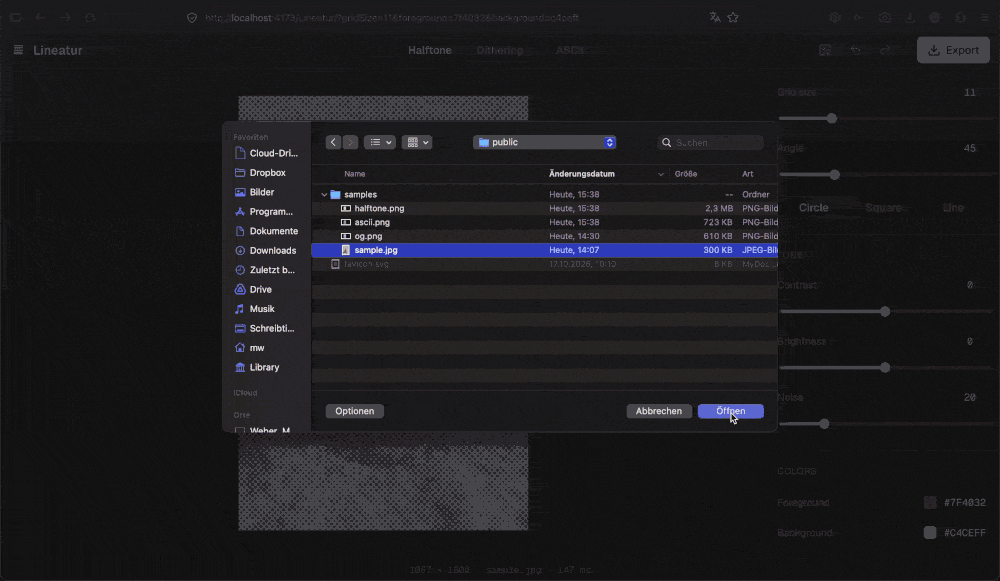
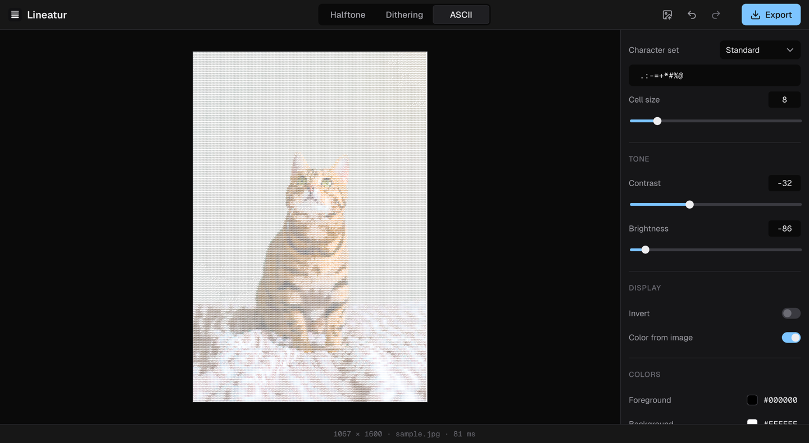
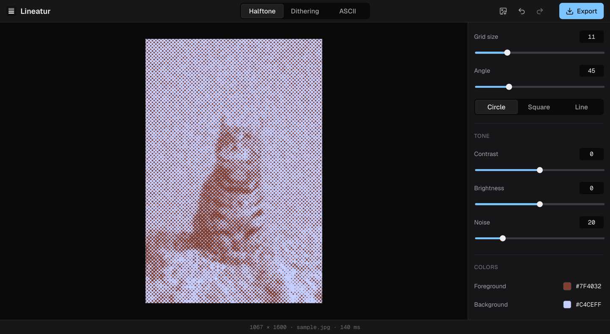

# Lineatur

**A browser-based Halftone, dither & ASCII tool **

[▶ Live demo](https://w3br.github.io/Lineatur/) · [Devlog](docs/devlog.md)



## What it is

Lineatur is an image effects studio inspired by print: halftone screens, dithering and ASCII art. Open a photo, tune the effect with a live preview, and export it in full resolution. Everything runs locally in your browser.

## Highlights

- effects run in a Web Worker with *latest-job-wins* scheduling, while a slider moves, only the newest setting is rendered
halftone (circle, square, line; rotated grid; deterministic noise), dithering (Floyd–Steinberg, Atkinson and Bayer, error diffusion is one algorithm with two kernels as data), ASCII (own character sets, emoji included)
- PNG, JPG and TXT export, with size parameters scaled from the preview to the original
- every setting lives in the URL and is validated on load, a broken link falls back to defaults instead of breaking the app
- undo and redo with slider changes grouped into one step
- native controls, keyboard only, visible focus, live status messages for screen readers, contrast checked against WCAG AA
- **475 unit tests** (Vitest + Testing Library), design tokens 1:1 from Figma, Lighthouse 100 in all four categories

## Design process

Designed in Figma first: a component library with variables, then four screens – empty state, halftone, dithering and ASCII. The variables became [`tokens.css`](src/styles/tokens.css), so code and design share every color, spacing and radius.

<!-- HTML instead of a Markdown table: GitHub sizes Markdown columns by image width, so the larger Figma export took more space -->
<table>
  <tr>
    <th width="50%">Figma</th>
    <th width="50%">App</th>
  </tr>
  <tr>
    <td></td>
    <td></td>
  </tr>
  <tr>
    <td></td>
    <td></td>
  </tr>
</table>

## Technical challenges

**1. A slider that lagged**
Floyd–Steinberg on a 1200 × 800 preview took 241 ms on average, up to 462 ms, the main thread couldn't react to the slider in that time. Moving the effects into a Web Worker didn't make them faster, but it stopped them from blocking. The worker only ever renders the newest job: one is rendering, at most one is waiting, everything in between is skipped. Because the effects were pure TypeScript from the start, they moved into the worker unchanged.

**2. Nothing rendered in Safari**
The app worked on my iPhone 15, but showed nothing in Safari on my Mac. The cause: Safari only supports `OffscreenCanvas` from version 16.4, and my Mac ran 15.6, the worker failed on every job. Instead of building a second render pipeline for old browsers, the app now checks for the feature before starting the worker and tells the user to update. Lesson: "works in Safari" depends on which Safari.

**3. Preview vs. export**
The preview renders at most 1200 px, the export uses the original (up to 4096 px). But sizes are set in preview pixels: grid size 8 on the preview equals 32 on a 4800 px original – without scaling, the export would look completely different. `scaleParams` multiplies only the size parameters by the factor; angle, tone and colors stay. Not rounded, because at a factor of 1.33 rounding would visibly shift the grid.

## What I learned

- Pure functions pay off twice, they are easy to test, and they could move into a worker without changes
- rotation tests at 45° showed 2 of 400 pixels staying white, pixel centers exactly on a cell border, fixed with half-open intervals
- `Number("")` is `0`, which passes `Number.isFinite` – `?gridSize=` would have become the minimum instead of the default
- an unknown export type returns a PNG, a too-large canvas in Safari stays empty
- the tertiary text color was 3.4 : 1, below the 4.5 : 1 that WCAG AA asks for

## How I used AI

I built Lineatur with Claude Code as a tutor and reviewer: it explained concepts and wrote tests and boilerplate; the effect algorithms, the worker pipeline and the store are my own code. The [devlog](docs/devlog.md) documents every decision along the way.

## Stack

React · TypeScript · Vite · Zustand · Web Workers + OffscreenCanvas · CSS Modules + design tokens · Vitest + Testing Library · GitHub Pages

Requires a current browser: Chrome 69+, Firefox 105+, Safari 16.4+.

## Run locally

Requires Node.js 22.12 or later.

```bash
npm install       # install dependencies
npm run dev       # start dev server on http://localhost:5173
npm run build     # type-check and build for production
npm run lint      # lint with oxlint
npm run test:run  # run all tests once
```

## License

[Apache 2.0](LICENSE)
