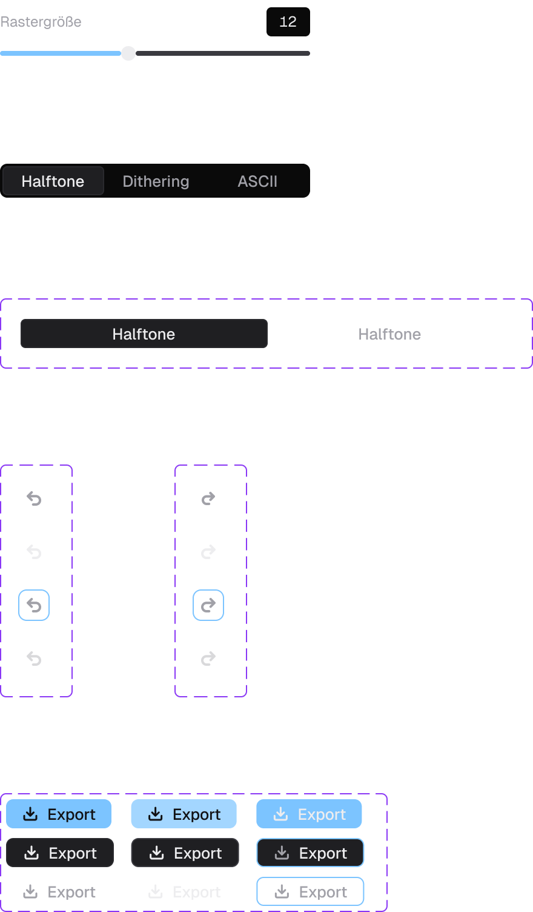
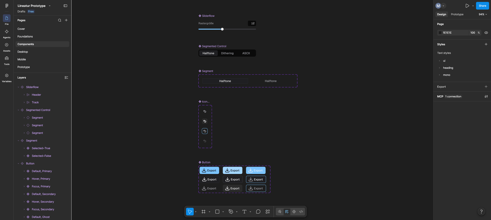
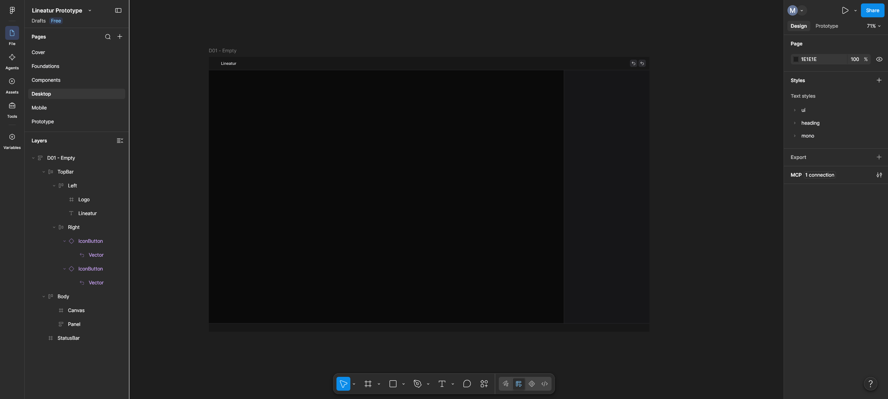

# Devlog

## Day 0 – Design foundations (2026-10-13)

**Concept**
- Scope: three effects (Halftone, Dithering, ASCII), focus on UX and visual quality over number of features
- Fully client-side: upload → edit → download, no backend
- Visual direction: minimal pro tool (references: Figma, Linear, DITHR), dark UI so the image stays in focus

**Figma**
- Variables: color tokens (dark mode), spacing scale (4 px grid), radius scale
- Accent color: light blue `#7CC4FF` – used only for primary action, active state and focus
- Text styles: Geist for UI (11–22 px), Geist Mono for numeric values
- App shell with auto layout: top bar 44 px, control panel 280 px, status bar 28 px
- Components: `Button` (primary / secondary / ghost × default / hover / focus), `IconButton`, `Segment` + `SegmentedControl` (effect switcher), `SliderRow`

**Decisions**
- Effect switcher as segmented control at the top of the panel – placed next to the controls it changes
- Slider rows with directly editable value field instead of slider + separate number box
- Focus ring with offset so it stays visible on the light-blue primary button

**Next**
- Main screen (Halftone), Dithering and ASCII variants, empty state
- Start development: Vite + React + TypeScript, tokens to CSS custom properties

## Day 1 – Setup, app shell and all panel components (2026-10-14 – 2026-10-19)

**Setup**
- Vite + React + TypeScript, oxlint, Vitest; Figma screens for v1 added to `docs/design/`
- Figma variables mapped 1:1 to CSS custom properties in `tokens.css`; components only use `var(--…)`
- `global.css`: box-sizing reset, form controls inherit the font, global `:focus-visible` ring, reduced motion

**Figma prototypes**

The four v1 screens: empty state, Halftone, Dithering and ASCII. The panels share one structure (sections with slider, select, switch and color rows), so each effect only differs in its controls.

  
  
  
  

Component sheet (slider row, segmented control, icon button and button states) and work in progress in Figma:

  
  
  

**App shell**
- `AppShell` as CSS grid with named areas: top bar, canvas, panel, status bar
- Top bar and status bar always stay visible, only the panel scrolls: rows use `minmax(0, 1fr)` instead of `1fr`, because a plain `1fr` track never shrinks below its content
- `TopBar` with `start` / `center` / `end` slots on a `1fr auto 1fr` grid, so the effect switcher stays exactly centered regardless of how wide the sides are
- Brand (favicon + "Lineatur" as `<h1>`), undo/redo, export; logo path built from `import.meta.env.BASE_URL` so it also works on GitHub Pages

**Components**
- `Button` (primary / secondary / ghost) and `IconButton` (`aria-label`, `aria-disabled` keeps it focusable)
- `SegmentedControl`: ARIA radiogroup with roving tabindex – one tab stop, arrow keys / Home / End move selection and focus, wraps around at both ends. Styled via `aria-checked`, so visuals and screen reader output can't drift apart
- `SliderRow`: custom-styled `<input type="range">` (WebKit + Firefox pseudo-elements), filled track via a `--fill` CSS variable set from React (Chrome has no progress pseudo-element)
- Editable value field in `SliderRow`: typing is kept as a local draft and committed on Enter / blur, clamped to min/max, comma accepted as decimal separator, Escape or invalid input reverts
- `SwitchRow`: `<button role="switch">` with `aria-checked`; the `<label>` points at the button, so clicking the text toggles too. Keyboard support comes free with the native button
- `SelectRow`: native `<select>` with `appearance: none` and a Lucide chevron laid over it (`position: absolute`, `pointer-events: none`); generic over the option values like `SegmentedControl`, shared `Option<T>` type in `types.ts`
- `ColorRow`: native `<input type="color">` as swatch (WebKit + Firefox swatch pseudo-elements) plus an editable hex field. `normalizeHex` in `lib/color.ts` accepts `#FF8800`, `ff8800` and `#f80` and returns `null` for anything else, so invalid input falls back to the old value
- `SegmentedControl` got an optional visible label (`showLabel`) that names the group via `aria-labelledby`
- `PanelSection`: `<section>` named by its `<h2>` title, divider only between sections (`.section + .section`)
- `TextField`: full-width mono input for the ASCII character set

**Panels**
- `HalftonePanel`, `DitheringPanel` and `AsciiPanel` assembled from the components, matching the Figma screens
- `App` picks the panel from a `Record<Effect, ComponentType>` map – TypeScript complains if a new effect has no panel
- ASCII: choosing a preset fills the character field, editing the field switches the select to "Custom"
- Rows have no outer spacing anymore; `PanelSection` sets the gap, all single-line rows share the 28 px control height

**Tests**
- Testing Library + jsdom; 64 tests across all components and `normalizeHex` (keyboard navigation, roving tabindex, clamping, label wiring, hex parsing, invalid input)

**Decisions**
- Effect switcher moved from the panel into the top bar (as in the Figma screens) – it switches the whole tool, not a single setting
- Controlled components only; state lives in the panels for now and moves to the Zustand store later
- Value field is `type="text"` with `inputMode="decimal"` instead of `type="number"`: no spinners, no accidental scroll-wheel changes, full control over parsing
- Layout spacing belongs to the parent (`gap`), not to the component (`margin` / `padding`)
- Native `<select>` and `<input type="color">` instead of custom widgets or `react-color` (unmaintained, always-open picker, no React 19 support): accessibility, keyboard and mobile pickers for free, zero bundle size
- No open animation for the select for now – the native list is drawn by the OS. `appearance: base-select` is an option later as progressive enhancement
- UI scaled to 120 %: at the Figma sizes (11–13 px text) the app felt too small to read. All size tokens moved from `px` to `rem` (Figma values kept as comments), and `html { font-size: 120% }` scales everything in one place. A percentage keeps the user's browser font-size setting working (WCAG 1.4.4); 1px borders stay in px so they stay crisp

**Learnings**
- Figma "hug contents" ≈ `width: fit-content`, "fill container" ≈ `flex: 1`, "spacing between items" = `gap`
- `transition` belongs in the base state, not in `:hover` – otherwise it only animates one way
- `preventDefault()` only for handled keys, otherwise Tab and Space break
- Browser default margins on `
` / `<h1>` break fixed-height bars
- Controlled components only show what they get: two switches bound to the same state always toggle together – one state per setting
- `position: absolute` needs a positioned ancestor (`position: relative`), otherwise it is placed relative to the page
- Lucide icons are strokes with `currentColor` – color them with `color`, not `fill`
- `<label htmlFor>` only works for form elements; groups like a radiogroup are named with `aria-labelledby`
- With `verbatimModuleSyntax`, type-only imports need `import type`

**Open issues**
- Panel state resets when switching effects, because each panel is unmounted – solved by the store

**Next**
- Zustand store for effect and parameters (incl. undo/redo history)
- Image upload, empty state (D01) and canvas preview
- First effect implementation and the worker pipeline

## Day 2 – Store and image loading (2026-10-20 – 2026-10-21)

**Store**
- Zustand store (`useEditorStore`) holds the active effect, one params object per effect and the loaded image. Panels read their slice with a selector, so a slider only re-renders the components that use it
- Param types and defaults live in `store/params.ts`. Union values are stable IDs (`"floyd-steinberg"`, `"1bit"`), the display labels stay in the UI – a typo in an ID is now a type error instead of a silently empty select
- `updateHalftone` / `updateDithering` / `updateAscii` take a `Partial<…>` patch and merge it into a new object (`{...state.halftone, ...patch}`). `set` replaces, `update` merges – the name says which one
- One user action = one update: the ASCII preset/characters logic sends both fields in a single patch, so undo won't have to step through half-finished states later
- Fixes the Day 1 bug: params survive switching effects, because they no longer live in the unmounted panel
- `loadFile(file)` action: decodes the file, stores the image and releases the old one. Drop, paste, the drop zone button and the top bar button all call this one action, so the rules below apply to every way of loading

**Image loading**
- `lib/loadImage.ts`: `createImageBitmap(file)` decodes the file directly (faster than `` + `onload`, and an `ImageBitmap` can be transferred to a worker later). Only PNG, JPEG and WebP are accepted
- Two versions per image: `original` in full resolution for export, `preview` with at most 1200 px on the long side for the live preview. A 6000 × 4000 photo is shown from a 1200 × 800 bitmap – the main performance decision of the project
- Four ways to load an image – drop, paste (Ctrl/Cmd+V), the drop zone button and "Open image" in the top bar – all end in `loadFile`. Unsupported files are logged and the current image stays
- Memory: a decoded `ImageBitmap` takes 4 bytes per pixel (≈ 96 MB for a 6000 × 4000 photo). `closeImage` releases both bitmaps right away instead of waiting for garbage collection – the old image only after the new one is shown. For small images `preview === original`, so it's closed once
- Race condition: decoding is async, so a large file chosen first could finish after a small file chosen second and overwrite it. Every load gets a number from a module-level counter; after `await`, a load that isn't the latest anymore is discarded and released. Like `switchMap` in RxJS: the latest *started* load wins, not the latest *finished* one

**Components**
- `DropZone` (empty state D01): icon, heading, accepted formats, "Choose image" button
- `ImageCanvas`: draws the bitmap in a `useEffect` after render; `canvas.width/height` set the pixel size (and clear the canvas), CSS `max-width/max-height` set the display size, so the aspect ratio is kept
- `CanvasArea` switches between drop zone and canvas and owns drop + paste for both states, so an image can be replaced by dropping or pasting a new one
- `StatusBar` shows `2400 × 1600 · photo.jpg` or "No image loaded"; export is disabled until an image is loaded

**Hooks**
- `usePasteFile` and `useFileDrop` in `src/hooks`. Paste and drop first lived in `DropZone`, but the drop zone is unmounted once an image is shown – and its listeners with it. In hooks, the logic runs as long as `CanvasArea` is mounted, which is always
- `useFileDrop` returns `{isDragging, handlers}`; the handler names match the React props, so they can be spread onto any element with `{...handlers}`
- `DropZone` became a presentational component: it gets `isDragging` as a prop instead of tracking drag state itself
- `useFilePicker` returns `{open, input}`: the hidden `<input type="file">` as a JSX element plus a function that clicks it. Used by the drop zone and the top bar, each with its own input. `accept` is built from `ACCEPTED_TYPES`, so the list of formats exists only once

**Accessibility**
- File picker: the template's `<label htmlFor>` wasn't focusable. Replaced by a `<button>` that calls `inputRef.current?.click()` on the hidden input – reachable with Tab, triggered with Enter/Space
- `<canvas>` is invisible to screen readers, so it gets `role="img"` and `aria-label="Preview of photo.jpg"` (WCAG 1.1.1 Non-text Content)
- "Open image" icon button in the top bar: replacing an image no longer requires dragging or knowing about paste (WCAG 2.2 2.5.7 Dragging Movements). Labelled "Open" rather than "Replace", because it works with and without an image and never has to be disabled

**Tests**
- 136 tests: store (immutability, defaults never mutated, params survive effect switch), `DropZone`, `ImageCanvas` (with a fake `getContext`), all three hooks, `CanvasArea` with a mocked `loadImage` (replace by drop/paste, invalid file keeps the image), `App` (open button, tab order)
- `loadImage`: type check and preview scaling with a stubbed `createImageBitmap` (6000 × 4000 → 1200 × 800, portrait, exactly 1200 px)
- `loadFile` races tested with hand-resolved promises (`deferred()`) instead of timers – the test decides which load finishes first. Verified that the tests fail when the request check is removed
- Checked in a real browser: small, huge and portrait images, window resize, replacing via drop, paste and the open button, PDF drop

**Decisions**
- Generic UI components get their state through props; only container components (`App`, `CanvasArea`) read the store. The first version of the export button read the store inside `Button` – which would have disabled every button in the app
- Drag feedback: the drop zone shows its own accent border; with an image, the wrapper shows a dashed outline (only then, so the two never appear together). `outline` instead of `border`, so the image doesn't shift by 2 px while dragging

**Learnings**
- Unmounting a component throws away its `useState` – state that has to survive belongs in a store (🅰️ like a field in a component inside `@if`)
- Never mutate store state (`state.halftone.gridSize = 12`) – Zustand and React only notice a new reference
- `useEffect` cleanup = subscribe + unsubscribe in one place. Without it, every paste would load the image once more per mounted listener
- Functions in a component body are new objects on every render. As a dependency (`[onFile]`), they re-run the effect – harmless here because `CanvasArea` only renders when the image changes; `useCallback` or `useEffectEvent` when it matters
- Grid items default to `min-height: auto` (= content height), which beats `max-height: 100%`. A portrait image overflowed until `min-height: 0` was added
- The well-known drag flicker (`dragleave` fires when moving onto a child element) doesn't show here: `dragover` fires continuously and sets the state back before the next frame. It hits implementations that set it in `dragenter`, which fires only once
- Template literals need backticks – `'Preview of ${image.name}'` renders the placeholder literally
- `function` declarations are hoisted, so a hook can receive `handleFile` before its line – it works, but reads backwards
- A counter that all calls share lives at module level (`let latestRequest`); the number of one call lives inside it (`const request`). Inside the function, every call would start at 0 and the check would never trigger
- With `verbatimModuleSyntax`, `import type` removes the import at build time – fine for types, wrong for functions like `loadImage` that run at runtime
- A hook can return JSX – it's just a value. The component decides where it's rendered; if it's never rendered, the ref stays `null` and `open()` silently does nothing
- `vi.mock` with a factory replaces the whole module: a new export (`ACCEPTED_TYPES`) was `undefined` in tests. Partial mocks (`importOriginal`) only replace what's needed
- A `catch` that only logs can hide bugs in tests too: a missing mock threw inside `loadFile`, got logged, and the test stayed green

**Open issues**
- Errors (unsupported file, decode failure) only go to the console – a toast follows later

**Next**
- Day 3: first effect – grayscale and threshold on `ImageData`, the base for all dithering algorithms

## Day 3 – First effect: dithering (2026-10-21 – 2026-10-22)

**Effects as pure functions**
- Everything in `src/effects/` is plain TypeScript without React: input in, result out. Easy to unit-test, and it can move into a Web Worker unchanged
- Data flow: `ImageData` (RGBA) → `toGray` → `Float32Array` (one value per pixel) → dithering → `Uint8ClampedArray` (0 or 255) → colors → `ImageData`
- The gray buffer is a `Float32Array`, because error diffusion needs values like `-23.4` or `281.7` that a clamped byte array would cut off

**Tone (`effects/tone.ts`)**
- `luminance`: weighted `0.299 R + 0.587 G + 0.114 B` – the eye sees green brighter than red and red brighter than blue
- `adjustTone`: brightness shifts, contrast scales around the midpoint 128 (`f = 259 (C + 255) / (255 (259 − C))`), result clamped to 0–255
- `toGray` combines both for every pixel

**Dithering (`effects/dither/`)**
- `threshold`: one fixed level – hard, flat areas, the reason dithering exists
- `bayer`: every pixel gets its own threshold from a repeating 4×4 matrix → regular dot patterns. The 16 thresholds are computed once at module level instead of once per pixel
- `errorDiffusion`: the rounding error of each pixel is passed on to neighbours that haven't been processed yet. Works on a copy, so the input stays untouched; neighbours outside the image are skipped (otherwise the error from the left edge would land at the end of the previous row)
- Floyd–Steinberg and Atkinson are **one algorithm with two kernels** – the kernels are data (`[dx, dy, weight][]`), so another algorithm like Stucki would just be another table
- `dither(image, params)` picks the algorithm (an exhaustive `switch` with `return` per case, so TypeScript complains if a new algorithm has no branch), then paints 0 with the foreground and 255 with the background color – ink on paper

**Atkinson vs. Floyd–Steinberg in numbers**
- 64 × 64 area, all gray 64 (≈ 25 % brightness): Floyd–Steinberg gives **25 %** white pixels, Atkinson only **18 %**
- Floyd–Steinberg passes on 16/16 of the error, so the average brightness is kept. Atkinson passes on only 6/8 – the rest is lost on purpose, which gives brighter lights, darker shadows and the original Macintosh look

**Live preview**
- `lib/render.ts`: the effect runs on a copy shrunk by the pixel size, and the result is scaled back up with `imageSmoothingEnabled = false` – one computed pixel becomes a crisp block. Pixel size 2 means a quarter of the pixels to compute
- `ImageCanvas` now renders the active effect instead of only drawing the bitmap. The plain image is just the case "no effect yet", so the existing component was extended instead of adding a second canvas
- Dependencies `[bitmap, effect, dithering]`: every slider change creates a new params object in the store (`{...state.dithering, ...patch}`), so React sees a new reference and re-renders. Halftone params changing doesn't re-render, because the component only selects `s.dithering`

**Measured** (1200 × 800 preview, Floyd–Steinberg, 11 contrast changes, headless Chrome)

| Pixel size | Avg per render | Max |
|---|---|---|
| 1 | 241 ms | 462 ms |
| 2 | 38 ms | 40 ms |
| 4 | 10 ms | 11 ms |

Bayer at pixel size 1: 98 ms. Above ~16 ms per frame the browser can't keep 60 fps – at pixel size 1 the sliders visibly lag, because the computation blocks the main thread

**Tests**
- 197 tests. Expected values for the effects were calculated by hand first (e.g. Floyd–Steinberg 4×1 at gray 100 → `[0, 255, 0, 0]`)
- Property tests check principles instead of single pixels: Bayer keeps the brightness exactly (gray 64 / 128 / 192 → 25 / 50 / 75 % white), Floyd–Steinberg keeps it on average
- Edge handling tested with one-direction kernels like `[[-1, 1, 1]]` – only possible because kernels are data
- Checked that the tests catch real mistakes by breaking the code on purpose (missing edge check, no copy, `=` instead of `+=`, swapped colors)
- `ImageCanvas` tests mock `renderEffect` and `dither` and only check the wiring; drawing itself is covered by `render.test.ts` with fake canvas contexts
- jsdom has no `ImageData` – the `dither` tests use a minimal stand-in class via `vi.stubGlobal`

**Tooling**
- Prettier added and the whole codebase formatted once (no semicolons, double quotes, 4 spaces, 120 columns). `tokens.css` is excluded so its size/line-height pairs stay on one line; the formatting commit is listed in `.git-blame-ignore-revs`

**Learnings**
- Floating point: `luminance(128, 128, 128)` is `127.99999999999999` – compare with `toBeCloseTo`, not `toBe`
- `Float32Array.map` returns a `Float32Array` again – to get another typed array, use `Uint8ClampedArray.from(source, fn)`
- `Object.assign({}, 128)` returns `{}` – numbers have no properties to copy. Typed arrays are copied with `Float32Array.from`
- `for (const [dx, dy, weight] of kernel)` – `for…of` with array destructuring. `for…in` would give the indices as strings
- Anything that doesn't depend on the pixel belongs before the loop – the hex colors are converted once, the Bayer thresholds once per app start
- Hooks only in the component body: `useRef` inside `useEffect` breaks the rules of hooks
- A test that can't fail isn't a test: writing past the end of a `Float32Array` is silently ignored, so "doesn't write below the last row" could never catch anything and was removed

**Open issues**
- The threshold slider does nothing for Bayer – the matrix *is* the threshold there. Options: hide/disable the slider for Bayer, or use the threshold as an offset
- The palette control (1 bit / 2 colors / 4 colors) has no effect yet. "1 bit" and "2 colors" probably mean the same to users – likely just *2 colors* vs. *4 levels*
- Pixel size 1 blocks the main thread for up to ~0.5 s per render
- Errors (unsupported file, decode failure) only go to the console – a toast follows later

**Next**
- Day 4: move `src/effects/` into a Web Worker, so the UI stays responsive while an effect is computed
- Then Halftone and ASCII
